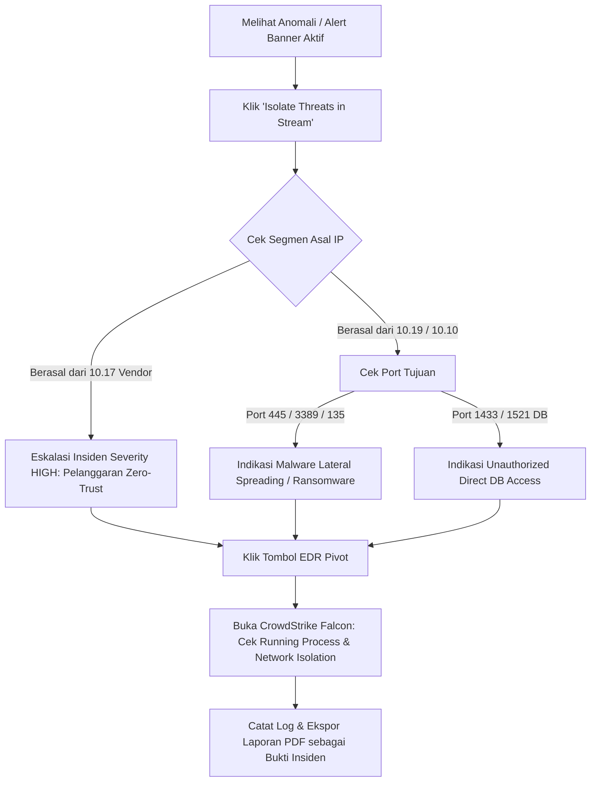

# Sentinel SOC - User Knowledge Sharing & SOP Operational Guide
**Platform Monitoring Keamanan Siber Terpadu - Clipan Finance (CFI)**  
*Dokumentasi Resmi Operasional untuk SOC Analyst (Tier 1/2/3), Incident Responder, & IT Security Management*

---

## 1. Pendahuluan & Gambaran Umum

Platform **Sentinel SOC** dirancang khusus sebagai pusat komando operasional keamanan (*Security Operations Center*) terpadu untuk memantau, mendeteksi, dan merespons ancaman siber secara *real-time* di seluruh lanskap infrastruktur teknologi informasi Clipan Finance.

Platform ini mengintegrasikan seluruh telemetri keamanan kunci:
- **Perimeter Firewall (FortiGate FGDC):** Perlindungan batas luar (*North-South*) terhadap serangan dari Internet dan DMZ.
- **Internal Segmentation Firewall (FortiGate ISFW):** Pengawasan lalu lintas internal (*East-West*), penegakan *Zero-Trust microsegmentation*, dan pencegahan *lateral movement*.
- **Next-Gen Firewall (Palo Alto Networks):** Inspeksi aplikasi canggih dan threat prevention.
- **Endpoint Detection & Response (CrowdStrike Falcon EDR):** Visibilitas proses pada workstation, server, dan isolasi host terinfeksi.
- **Privileged Access Management (CyberArk PAM):** Pengawasan sesi akses istimewa (*privileged sessions*) dan anomali kredensial admin.
- **Database Activity Monitoring (Imperva SecureSphere DAM):** Audit transaksi data sensitif dan pencegahan *SQL injection / data leakage*.

---

## 2. Peta Subnet Jaringan Enterprise Clipan Finance

Untuk mempermudah pemantauan tanpa perlu membuka tabel IPAM terpisah, seluruh alamat IP di dalam modul ISFW secara otomatis dipetakan ke dalam konteks entitas berikut:

| Subnet CIDR | Entitas Segmen | Role & Kebijakan Keamanan | Tingkat Sensitivitas |
| :--- | :--- | :--- | :--- |
| **`10.19.0.0/16`** | **Wi-Fi CFI-IT** | Jaringan nirkabel khusus tim IT internal Clipan Finance. Diberikan hak akses jumpbox administratif terdaftar, namun tetap diawasi secara ketat. | Medium / Monitored |
| **`10.17.0.0/16`** | **Wi-Fi CFI-Vendor** | Jaringan nirkabel rekanan/pihak ketiga/tamu. **Isolasi Zero-Trust Mutlak**: Dilarang keras menyeberang langsung ke Corporate LAN atau Datacenter. | Restricted / Untrusted |
| **`10.10.0.0/16`** | **Corporate LAN** | Workstation & laptop resmi karyawan Clipan Finance. Akses ke server database harus melalui aplikasi perantara (*tiering*). | Trusted Internal |
| **`10.100.101.0/24`** | **DC Core / DB Farm** | **Crown Jewel Asset**: Server basis data inti (Oracle, MS-SQL, PostgreSQL) transaksi pembiayaan. Akses langsung non-aplikasi diblokir. | **CRITICAL (Crown Jewel)** |
| **`10.100.103.0/24`** | **IT Admin Mgmt** | Server manajemen, jumpbox administratif, dan konsol infrastruktur. Akses dibatasi hanya untuk personel IT terotentikasi. | High / Restricted |

---

## 3. Fitur Utama Dashboard FortiGate ISFW & Fungsinya

### A. Early Warning Threat Surge Banner
- **Fungsi:** Panel peringatan darurat yang otomatis muncul di bagian paling atas jika terjadi anomali lonjakan penolakan paket (*drop ratio > 8%*) atau jika ada aktivitas *lateral movement* aktif di dalam jaringan.
- **Tindakan Cepat:** Klik tombol **`[⚡ Isolate Threats in Stream]`** untuk langsung memfilter live stream khusus pada paket-paket ancaman yang diblokir.

### B. Dual-Telemetry Timeline Chart (Allowed vs Denied)
- **Fungsi:** Grafik area interaktif yang memisahkan volume lalu lintas normal (**Allowed** - Hijau) dengan lalu lintas mencurigakan yang diblokir (**Denied Drops** - Merah Marun).
- **Kegunaan Analis:** Menemukan *spike* (lonjakan mendadak) pada kurva merah yang mengindikasikan serangan *scanning*, infeksi worm, atau upaya brute force jaringan internal.

### C. High-Risk Lateral Threat Probers (Triage Queue)
- **Fungsi:** Tabel pemeringkat host internal yang menghasilkan penolakan (*denial*) terbanyak.
- **Informasi yang Ditampilkan:**
  - IP Sumber dan badge segmen asalnya (`WIFI-IT`, `WIFI-VENDOR`, `CORP-LAN`).
  - Total jumlah paket yang diblokir.
  - Port spesifik yang diserang beserta aplikasi (misal: `Port 445 SMB`, `Port 3389 RDP`).
  - Pemetaan taktik **MITRE ATT&CK** (misal: `T1021.002 SMB Spreading`).
  - **Tombol Aksi SOC:**
    - **`[🛡️ EDR]`**: Langsung membuka konsol CrowdStrike Falcon EDR untuk menginvestigasi host tersebut.
    - **`[Filter Prober]`**: Memfilter live stream log khusus untuk host tersebut.

### D. Zero-Trust Inter-Segment Communication Matrix
- **Fungsi:** Memvisualisasikan matriks kepatuhan komunikasi antar-zona secara menyeluruh (*Zone-to-Zone Flow*).
- **Titik Pantau Utama:**
  - `Wi-Fi CFI-Vendor` ➔ `Corporate LAN` : Status **`BLOCKED (ZERO-TRUST)`** (Harus 100% diblokir).
  - `Wi-Fi CFI-Vendor` ➔ `DC Core DB Farm` : Status **`BLOCKED (ZERO-TRUST)`** (Harus 100% diblokir).
  - `Wi-Fi CFI-IT` ➔ `IT Admin Mgmt` : Status **`PERMITTED`** (Akses administratif terdaftar).
  - `Corporate LAN` ➔ `DC Core DB Farm` : Status **`PERMITTED (FILTERED)`** (Akses aplikasi terfilter).
- **Interaksi:** Analis dapat mengklik tombol **`[Audit Pathway]`** untuk memeriksa seluruh riwayat log pada jalur komunikasi tersebut.

### E. Live Syslog Stream Toolbar & Deteksi MITRE
- **Pills Filter Cepat:**
  - **`[⚡ Lateral Threats Only]`**: Hanya menampilkan paket yang cocok dengan teknik penyerangan lateral (SMB, RDP, SSH, RPC, DB probe).
  - **Filter Segmen**: Memfilter per segmen `Wi-Fi CFI-IT`, `Wi-Fi CFI-Vendor`, `Corporate LAN`, atau `DC Core DB Farm`.
- **Badging Visual:**
  - **`ZT-CROSS`**: Penandaan merah terang jika ada lalu lintas vendor yang mencoba melanggar batas *Zero-Trust*.
  - **`★ Crown Jewel Target`**: Penandaan emas jika tujuan paket adalah server database inti.

### F. Draggable Detail Log Inspector
- **Fungsi:** Jendela modal detail log yang dapat digeser (*drag-and-drop*) di layar sehingga analis tetap dapat memantau pergerakan live stream di belakangnya.
- **Fitur di dalamnya:**
  - **Visual Traversal Flow:** Menampilkan diagram alur perpindahan paket dari subnet asal ke subnet tujuan.
  - **MITRE ATT&CK Remediation Card:** Panduan teknis penanganan insiden (rekomendasi isolasi host dan penutupan port).
  - **Raw Syslog Wire Message:** Tampilan teks mentah log asli dari perangkat FortiGate untuk kebutuhan bukti audit.
  - **Tombol Pivot EDR:** Membuka investigasi host langsung di CrowdStrike.

### G. Formal PDF & CSV Audit Export
- **Fungsi:** Menghasilkan dokumen laporan resmi siap cetak untuk kebutuhan audit kepatuhan regulasi (**POJK 11 / OJK CSIRT, ISO 27001 A.13.1, dan PCI-DSS 1.3**) lengkap dengan kolom tanda tangan formal pimpinan SOC dan CISO.

---

## 4. Standar Operasional Prosedur (SOP) Analis SOC

Berikut adalah panduan langkah demi langkah saat analis mendeteksi anomali pada dashboard ISFW:

### Skenario 1: Terdeteksi Pelanggaran Batas Zero-Trust (Vendor Wi-Fi Traversal)
1. **Identifikasi:** Live stream memunculkan badge merah **`ZT-CROSS`** dengan IP sumber `10.17.x.x` menuju `10.10.x.x` atau `10.100.101.x`.
2. **Verifikasi:** Klik log tersebut untuk membuka **Detail Log Inspector**. Pastikan action bernilai `deny` (artinya firewall berhasil memblokir).
3. **Penyelidikan Host:** Klik tombol **`[Investigate Host in CrowdStrike EDR]`** untuk melihat apakah laptop vendor tersebut terpasang sensor EDR atau melakukan pemindaian massal.
4. **Tindakan:** Jika terbukti melakukan scanning aktif, hubungi tim Network/Helpdesk untuk mencabut akses Wi-Fi perangkat vendor terkait (*MAC address ban / session disconnect*).

### Skenario 2: Terdeteksi Percobaan Penyebaran Lateral (SMB / RDP Probe)
1. **Identifikasi:** Banner **High-Risk Lateral Threat Probers** mendeteksi host internal dengan ribuan paket deny pada port 445 (SMB) atau 3389 (RDP).
2. **Analisis Taktik:** Periksa kolom MITRE (`T1021.002 SMB Spreading`). Ini merupakan indikasi kuat infeksi malware atau worm yang berusaha menyebar ke komputer lain.
3. **Respon Cepat:** Buka link EDR host tersebut, lalu lakukan **Network Containment / Isolation** melalui konsol CrowdStrike agar host tidak dapat berkomunikasi dengan workstation lain di kantor.
4. **Pelaporan:** Ekspor ringkasan insiden ke format PDF melalui tombol **`[Export Audit]`** untuk arsip tiket insiden tim IT Security.

---

## 5. Glosarium Singkat

- **ISFW (Internal Segmentation Firewall):** Firewall yang ditempatkan di dalam jaringan lokal untuk mengontrol dan memfilter lalu lintas antar-VLAN/antar-departemen.
- **East-West Traffic:** Lalu lintas data internal antar komputer/server di dalam jaringan lokal yang sama.
- **North-South Traffic:** Lalu lintas data dari dalam jaringan menuju ke luar (Internet) atau sebaliknya.
- **Crown Jewel Asset:** Aset data paling bernilai bagi perusahaan yang jika bocor atau rusak akan melumpuhkan operasional (misal: Database Inti Pembiayaan).
- **MITRE ATT&CK:** Basis data global tentang taktik, teknik, dan prosedur nyata yang digunakan oleh penyerang siber.
- **EDR (Endpoint Detection and Response):** Perangkat lunak keamanan yang memonitor aktivitas proses di komputer untuk mendeteksi ancaman yang lolos dari antivirus konvensional.
- **POJK 11/2022:** Peraturan Otoritas Jasa Keuangan mengenai penyelenggaraan teknologi informasi dan ketahanan siber oleh lembaga jasa keuangan.
